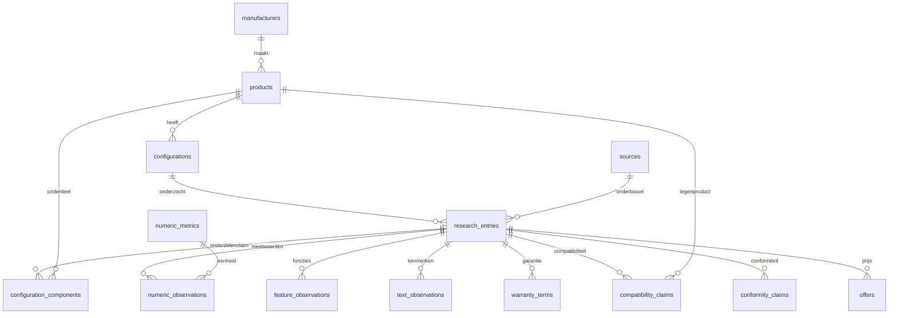

# SQLite-onderzoekscatalogus

De eerste migratie staat in `crates/storage/migrations/0001_research_catalog.sql`. De Rust-domeintypen staan in `thuisaccu_core::products`; `thuisaccu-storage` verzorgt SQLite via rusqlite. Het [onderzoek](battery-research.md) motiveert de gekozen gegevens.

## Relaties



Identiteitsrijen worden door de onderzoeker aangemaakt. Een product heeft een fabrikant, naam, modelcode en type (`battery_module`, `battery_system`, `inverter`, `controller`, `gateway`, `accessory`). Een configuratie benoemt een concrete uitvoering en hardwarerevisie. Onderdelen en aantallen zijn zelf bronclaims en hangen daarom aan een research-entry voor die uitvoering. Er vindt geen automatische optelling van modules naar systeemcapaciteit plaats.

Iedere research-entry verwijst verplicht naar één configuratie en één bron en bewaart een vindplaats, waarnemingstijd, marktcontext, eventuele firmware, voorwaarden en notities. Gebruik voor niet bekende marktcontext expliciet `unspecified`; een vrij regiolabel wordt niet automatisch vertaald naar landen. Splits entries wanneer bron, regio, firmware of voorwaarden verschillen. Eén entry kan meerdere bevindingen uit dezelfde tabel bevatten.

Productbronnen bevatten type, titel, HTTP(S)-URL of een interne `urn:thuisaccu:manual:`-verwijzing voor eigen invoer, optionele documentrevisie, publicatiedatum, raadpleegmoment, SHA-256 en archiefpad. Een URL mag vaker voorkomen: de inhoud kan wijzigen. De database downloadt of archiveert geen productdocumenten en berekent daarvoor geen hashes. Revisie en eventuele hash worden door de invoerder gecontroleerd; een bestandsnaam is geen bewijs van de inhoudelijke versie. De opwekimport berekent wel een bestands-hash, in een afzonderlijke tabel.

## Waarden en eenheden

Numerieke eigenschappen zijn geen vrije sleutel/waardevelden. `NumericMetric` en de tabel `numeric_metrics` vormen een gecontroleerde lijst met vaste eenheden, grenzen en waar nodig gehele aantallen. De database bewaakt die grenzen bij invoegen én wijzigen. De catalogus bevat nu 43 metrics:

| Categorie | Metriccodes | Eenheid |
| --- | --- | --- |
| Energie | `nominal_energy_wh`, `usable_energy_wh`, `max_system_energy_wh` | Wh |
| Werkelijk vermogen | `continuous_charge_power_w`, `continuous_discharge_power_w`, `peak_discharge_power_w`, `backup_power_w`, `standby_power_w`, `pv_input_power_w` | W |
| Schijnbaar vermogen | `apparent_power_va` | VA |
| Rendement/capaciteit | `round_trip_efficiency_pct`, `charge_efficiency_pct`, `discharge_efficiency_pct`, `depth_of_discharge_pct`, `end_of_life_capacity_pct` | % van 0 tot 100 |
| Zelfontlading | `self_discharge_pct_per_month` | %/maand |
| Levensduur | `cycle_life_cycles`, `design_life_years` | cycli, jaren |
| Elektrisch | `nominal_voltage_v`, `operating_voltage_v`, `continuous_charge_current_a`, `continuous_discharge_current_a`, `peak_current_a`, `grid_frequency_hz` | V, A, Hz |
| Aantallen | `phase_count`, `module_count`, `max_parallel_units`, `mppt_count` | geheel aantal |
| Fysiek | `height_mm`, `width_mm`, `depth_mm`, `weight_kg` | mm, kg |
| Omgeving | `charge_temperature_c`, `discharge_temperature_c`, `storage_temperature_c`, `noise_db_a`, `max_altitude_m`, `relative_humidity_pct` | °C, dB(A), m, % |
| Tijd | `peak_duration_s`, `transfer_time_ms`, `settling_time_s` | s, ms, s |
| Onafhankelijke benchmark | `system_performance_index_5kw_pct`, `system_performance_index_10kw_pct` | % per eigen referentiegeval |

Een numerieke waarneming bewaart ook de oorspronkelijke korte waardeweergave (`reported_value`), de meetgrens en testcondities. Converteer bijvoorbeeld kWh naar Wh bij invoer en behoud de originele weergave. `REAL`/`f64` is hier bedoeld voor gepubliceerde technische waarden; geld gebruikt uitsluitend integers. Rond brongegevens niet stilzwijgend af.

`qualifier` onderscheidt `exact`, `approximate`, `at_least`, `at_most`, `less_than`, `greater_than` en `range`. Alleen `range` gebruikt `upper_value`; het interval is inclusief beide grenzen. Een strikt of open interval kan als afzonderlijke grensclaims met toelichting worden vastgelegd. Bij een door de bron exact weergegeven getal betekent `exact` geen foutloze laboratoriummeting.

De meetgrens is verplicht: `battery_dc`, `system_ac`, `dc_dc`, `ac_ac`, `pv_ac` of `unspecified`. De betekenis van `pv_ac` is het pad van PV via opslag naar AC. Een grens is alleen bruikbaar in combinatie met de metric en de bronprocedure. Bij onvoldoende broninformatie blijft deze `unspecified`; vergelijk zulke waarden niet automatisch met een AC-systeemrendement.

Testtemperatuur, testvermogen, SoC, DoD en C-rate zijn optionele aparte kolommen; overige voorwaarden blijven tekst. Meerdere waarnemingen van dezelfde metric zijn toegestaan, bijvoorbeeld voor meetpunten bij verschillende vermogens. Leg piekduur en piekvermogen in dezelfde entry vast met corresponderende voorwaarden. Er is nog geen curvefit of afleiding uit spanning maal stroom.

## Functies en kwalitatieve kenmerken

`feature_observations` gebruikt gecontroleerde keys voor back-up, eilandbedrijf, black-start, driefasenback-up, asymmetrie, netladen/-export, dynamische tarieven, lokale API, afstandssturing, offlinewerking, cloud/abonnement, binnen/buiten, uitbreiding en inbegrepen omvormer/EMS. De status is `supported`, `unsupported`, `conditional` of `unknown`. Bij `conditional` zijn voorwaarden verplicht. Geen rij betekent nog niet onderzocht; een `unknown`-rij kan een expliciete onderzoeksbevinding documenteren.

`text_observations` bewaart per rij één kwalitatieve vermelding, zoals chemie, koppeling, fasetopologie, IP-rating, koeling, montage, communicatie, stuurprotocol, EMS-aanbieder, benodigde accessoires, installatievereisten, recycling, reparatie of serviceregio. De waarden zijn brongetrouwe tekst en nog geen automatisch genormaliseerde taxonomie. Twee protocollen krijgen twee rijen. Vermeld bij bijvoorbeeld een IP-rating of gewicht altijd het relevante onderdeel in de voorwaarden.

## Garantie, compatibiliteit en conformiteit

- Garantie: product- en prestatiemaanden, capaciteitbehoud, cycli en energie-doorzet in Wh. `limit_rule` beschrijft of grenzen als eerste gelden, anders werken of niet zijn vermeld. Toepassing en uitsluitingen blijven zichtbaar. Activatie, internet, inbegrepen arbeid en overdraagbaarheid zijn optionele booleans; `NULL` blijft onbekend. De doorzet-meetgrens en startvoorwaarden horen in de entryvoorwaarden. Ontwerplevensduur en cyclusmetingen worden niet naar garantie gekopieerd.
- Compatibiliteit: tegenproduct, status (`compatible`, `incompatible`, `conditional`, `required`), firmwarevereisten en minimale/maximale module- en parallelaantallen. Voorwaardelijke claims vereisen toelichting. Een relatie bewijst geen andere combinaties of regionale netgoedkeuring.
- Conformiteit: norm, editie, status (`claimed`, `certified`, `tested`, `pending`), certificaatreferentie en scope. `certified` is een geregistreerde bronclaim; de software controleert geen certificaatregisters en leidt uit één norm geen algemene veiligheid af.

## Aanbiedingen

Een aanbieding hoort bij één configuratie en één bron-entry. Bewaar verkoper, valuta, minor-unit-exponent, aanschafbedrag, eventueel periodiek bedrag met maand/jaar, belastingbasis en eventueel belastingtarief in basispunten. `999999` met exponent `2` betekent `9999,99`; exponent `0` en `3` ondersteunen andere valutaprecisies. Valutacodes moeten drie hoofdletters zijn; de database raadpleegt geen ISO-valutaregister en rekent valuta niet om.

De flags voor inbegrepen accu, omvormer, gateway, installatie en levering zijn drie-waardig: ja, nee of onbekend. Een onbekende installatieprijs mag niet als nul worden ingevoerd. De aanbieding beschrijft één exemplaar van de benoemde configuratie; gebruik een andere configuratie voor een meervoudig pakket. Aanvullende kosten en uitzonderingen worden als tekst bewaard. De geldigheidsgrens en beschikbaarheid zijn expliciet. `NULL` bij abonnementskosten bewijst niet dat er geen abonnement vereist is.

Dit onderzoeksmodel bewaart prijswaarnemingen. De aparte scenario-invoer legt componentgewijze extra kosten, tarieven, looptijd en financiële aannames vast; de rekenkern berekent daarmee rendement. Er wordt geen fiscaal recht afgeleid uit een prijswaarneming. Complexe dynamische tariefschema's worden nog niet gemodelleerd.

## Kwaliteit, historie en validatie

- Nieuwe entries zijn `unreviewed`. `reviewed`, `disputed` en `superseded` vereisen een benoemde reviewer en controle-tijd vanaf het waarnemingsmoment. `reviewed` betekent gecontroleerde transcriptie/context, geen onafhankelijke bevestiging van een fabrikantclaim.
- Bronclaims uit verschillende bronnen blijven afzonderlijk bestaan. De opslagmethoden voegen toe en kiezen geen 'beste', 'laatste' of 'ware' specificatie. `numeric_research` toont alle review-statussen.
- Niet bekende numerieke eigenschappen krijgen geen rij. Optionele garantie-, prijs- en testvelden gebruiken `NULL`. De database maakt onbekend nergens tot nul of `false`.
- Alle eigen tabellen zijn `STRICT`; foreign keys staan op iedere applicatieverbinding aan. CHECK-constraints bewaken codes, bereiken, booleans, geldbedragen, geldigheid van publicatiedata en hashes. Triggers bewaken metricgrenzen. Rust weigert ook NaN en oneindige getallen voordat SQLite die zou kunnen omzetten.
- Er is geen cascade-delete. Gegevens met afhankelijke onderzoeksclaims kunnen niet stilzwijgend worden verwijderd. Dit is geen onveranderbaar auditlog: directe SQL kan bestaande rijen wijzigen. Bewaar nieuwe bronversies als nieuwe records en markeer correcties expliciet.
- Alle `*_unix_s`-velden zijn seconden sinds de Unix-epoch in UTC. `published_on` is een datum `YYYY-MM-DD`; een onbekende dag blijft `NULL` met eventuele toelichting in de notities.

## Gebruik en migraties

De server opent standaard `data/research.sqlite3`, maakt de map aan en voert de ingebouwde migraties uit vóór het openen van de HTTP-poort. `DATABASE_PATH` is een bestandspad, geen SQLite-URL. SQLite wordt meegebouwd; een aparte databaseserver is niet nodig. De browserversie houdt dezelfde database in het geheugen en bewaart hem als bytes in IndexedDB (zie [architectuur](architecture.md)).

De opslagbibliotheek biedt `Catalog::open`, `Catalog::in_memory`, `Catalog::from_bytes` en `Catalog::to_bytes` (database als bestandsinhoud, voor de browser en back-ups), typed `add_*`-methoden voor alle entiteiten, `list_products` en `list_numeric_observations`. `Catalog::connection()` geeft de rusqlite-verbinding voor verdere queries en transacties. Losse `add_*`-aanroepen zijn elk één atomische write; gebruik een expliciete transactie (`connection().transaction()`) voor een import die volledig moet slagen of terugrollen. Houd de verbinding niet vast over een `.await` heen.

Migraties zitten in de executable. Voeg een volgende genummerde migratie toe voor schemawijzigingen; wijzig geen migratie die al op een gedeelde database is toegepast. De tabel `_sqlx_migrations` (dezelfde vorm als eerdere versies met SQLx) bewaart per versie een SHA-384-controlegetal van de SQL; een gewijzigde of onbekende (nieuwere) migratie laat het openen mislukken. Een nieuwe migratie krijgt een regel in `MIGRATIONS` in `crates/storage/src/migrations.rs`. De build wordt opnieuw uitgevoerd als migratiebestanden wijzigen.

Bestandsdatabases gebruiken WAL, `synchronous=FULL`, één verbinding en een busy-timeout van vijf seconden; bij afsluiten wordt de WAL teruggeschreven, zodat het bestand op zichzelf compleet is. Externe SQLite-clients moeten zelf `PRAGMA foreign_keys = ON` instellen. Testdatabases draaien geïsoleerd in geheugen of in een tijdelijke map.

Open het bestand eventueel met een SQLite-client. De volgende query maakt een onderzoeksdossier leesbaar en behoudt de herkomst:

```sql
SELECT manufacturer_name, product_name, configuration_name,
       metric_key, qualifier, value, upper_value, unit, boundary,
       test_temperature_c, test_power_w, conditions, entry_conditions,
       source_url, document_revision, locator, market, review_status
FROM numeric_research
ORDER BY manufacturer_name, product_name, configuration_name, metric_key, id;
```

Voor een consistente eenvoudige back-up: stop de applicatie en alle databaseclients volledig voordat je het bestand kopieert. Bij een draaiende WAL-database is alleen het hoofdbestand kopiëren onvoldoende; gebruik dan de [SQLite-back-upinterface](https://sqlite.org/backup.html) of de backupfunctie van je client. Databasebestanden en de standaardmap `data/` staan buiten Git.

De eerste browserinterface ondersteunt vergelijken en snelle dossierinvoer; `/api/v1/comparison` levert het leesmodel en `/api/v1/products` de identiteiten. Snelle invoer is een subset van het volledige onderzoeksmodel. Uitgebreide compatibiliteits-, conformiteits- en garantie-invoer blijft beschikbaar via de typed opslagmethoden. Zie [API](api.md).

Migratie 0002 voegt `solar_imports`, `solar_intervals` en een marker per geladen referentiemomentopname toe (de interface laadt ontbrekende sets automatisch bij). Opwekimports bewaren instellingen, bestands-hash, samenvatting en genormaliseerde intervallen, niet het ruwe bestand. Zie [importafspraken](solar-import.md). De UI ondersteunt eigen offertes, prijs per opgegeven bruikbare kWh en export van de zichtbare vergelijking. Die kengetallen zijn geen financiële scenarioberekeningen.

Migratie 0004 voegt aan `solar_intervals` de optionele kolom `steady_consumption_wh` toe: het deel van het bruto verbruik dat binnen het interval gelijkmatig loopt (warmtepomp en laadpaal in een geschat keuzehulpprofiel). Gemeten imports laten haar leeg. Een CHECK houdt de waarde tussen nul en `consumption_wh`; de opslag controleert hetzelfde. De rekenkern verdeelt alleen het overige verbruik volgens gemeten huishoudens ([rekenmethode](roi-model.md#verbruik-binnen-een-meetperiode)).

Migratie 0005 voegt aan `solar_intervals` de optionele kolommen `measured_import_wh` en `measured_export_wh` toe: netafname en teruglevering volgens de meter zonder accu, gevuld bij een import met P1-netafname en teruglevering of een meterbestand. Een CHECK eist dat ze samen leeg of samen gevuld zijn, niet negatief zijn en alleen naast `consumption_wh` voorkomen; de opslag controleert hetzelfde. Wordt hetzelfde bestand met dezelfde instellingen opnieuw geïmporteerd, dan vult de opslag alleen ontbrekende meterwaarden van het bestaande profiel aan; andere waarden en eerdere runs veranderen niet. De rekenkern bepaalt er de gelijktijdigheid binnen de periode mee ([rekenmethode](roi-model.md#gemeten-netafname-en-teruglevering)).

Migratie 0003 voegt `analysis_runs` toe. Iedere rij koppelt een analyse aan `solar_imports` en bewaart scenarionaam, UTC-aanmaaktijd, modelversie, SHA-256 van het genormaliseerde energieprofiel en JSON voor de volledige invoer en uitkomst. De invoer bevat adres/optionele BAG-coördinaten, importmetadata, technische kandidaten, alle kostenregels, tarieven, doel en bevestigde aannames. Het resultaat bevat jaarlijkse energiestromen/kasstromen, ROI, NPV, terugverdientijd, varianten, aanbeveling en waarschuwingen. JSON-kolommen zijn geldig JSON; de getypeerde rekenkern valideert het inhoudelijke contract. De bedragen in deze geprojecteerde uitkomsten zijn `f64`-schattingen, in tegenstelling tot de ingevoerde gehele eurocenten.

`Catalog::solar_intervals`, `solar_metadata`, `save_analysis` en `list_analyses` ondersteunen deze route. Historie levert de laatste 100 analyses, inclusief hun oorspronkelijke invoer en resultaat. Brongegevens worden via de foreign key behouden; de hash vervangt geen back-up van de intervallen. Een run wordt nooit gewijzigd, alleen op verzoek van de gebruiker verwijderd (`delete_analysis`). `delete_solar` verwijdert een profiel in één transactie samen met zijn intervallen en alle runs erop, zodat geen run naar een ontbrekend profiel wijst; de interface noemt het aantal runs (`analysis_runs` in `list_solar`) en vraagt eerst bevestiging. Gedeelde links bevatten de uitkomst zelf en blijven werken. Cataloguswijzigingen of gewijzigde formuliervelden herschrijven eerdere uitkomsten niet. Zie [rekenmethode](roi-model.md).
